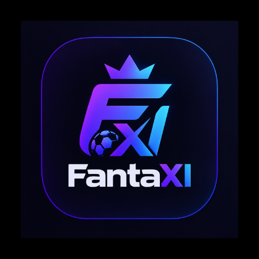

<div align="center">
  
  <h1>FantaXI</h1>
  <p>A Fantasy Premier League companion for your squad, leagues, and live gameweeks.</p>
</div>

FantaXI is a Flutter app for following a Fantasy Premier League manager entry. It brings team picks, league standings, season history, live gameweek scores, fixtures, and player comparisons together in a football-focused dashboard.

## Screenshots

| Home | Squad | Leagues |
|:---:|:---:|:---:|
| 
| 
| |

| League standings | Gameweek points | History |
|:---:|:---:|:---:|
| 
|
| |

| Market | Matches | Match timeline |
|:---:|:---:|:---:|
| 
| 
 | 
|

| Lineups | Match stats | Appearance |
|:---:|:---:|:---:|
|
| 
| 
|

| Splash | Onboarding |
|:---:|:---:|
| 
| 
|

## Features

- **Home dashboard** - manager overview, season totals, overall rank, squad value, gameweek progress, and the gameweek MVP.
- **Squad picks** - view a manager's lineup, formation, captain and vice-captain, and substitutes bench for a gameweek.
- **Leagues** - browse every classic and mini-league, filter by type, and search leagues and cups.
- **League standings** - overall and gameweek points views, your position, points to first place, manager search, and Top 10 / Near Me / Rivals filters.
- **History** - overall rank trajectory chart, best rank and best gameweek, transfers, squad value, bench points, and per-gameweek results with chips.
- **Market** - search and browse players by position and price, with form, points, and team filters.
- **Matches** - matchweek fixtures grouped by day, live scores, and match details with timeline, lineups, statistics, commentary, and table tabs.
- **Live gameweek** - follow player points and live statistics.
- **Appearance** - light, dark, and system themes, plus changing the connected manager ID.
- **Onboarding** - connect the app to a manager entry ID.

## Technology

- Flutter and Dart
- `flutter_bloc` and Cubit for state management
- `go_router` for navigation
- `dio` for HTTP requests
- `get_it` for dependency injection
- `dartz` for typed repository results
- [Fantasy Premier League API](https://fantasy.premierleague.com/api)

## Getting started

### Requirements

- Flutter SDK with Dart `^3.7.0`
- Android Studio and Android SDK for Android development
- Xcode on macOS for iOS development

### Install and run

```bash
git clone https://github.com/ElsaidAtif14/FantaXI.git
cd FantaXI
flutter pub get
flutter run
```

Choose a connected device with `flutter devices`. To create an Android release APK:

```bash
flutter build apk --release
```

## Architecture

The app uses a feature-first structure. Each API-backed feature separates its presentation Cubit, domain repository contract, data repository implementation, and response models.

API requests follow this flow:

1. A Cubit requests data through a repository interface.
2. The repository implementation calls `DioClient` and parses a typed model.
3. The repository returns `Either<Failure, Model>` to represent success or failure.
4. The Cubit emits loading, loaded, or error state for the UI.

Repositories and Cubits are registered in `lib/core/di/injection.dart`. API endpoints and local storage keys are defined in `lib/core/constants/app_constants.dart`.

```text
lib/
|-- core/       # API client, dependency injection, routing, errors, and theme
|-- features/   # bootstrap, history, home, league, live, manager, market,
|               # matches, onboarding, picks, and splash
`-- shared/     # reusable widgets
assets/
|-- images/
|   `-- screenshots/  # app screenshots used in this README
```

## Data and generated files

FantaXI reads football data from the public Fantasy Premier League API. The manager entry ID and onboarding status are stored locally on the device. The configured API endpoints do not require credentials.

Build outputs, local tool state, and generated platform files are excluded through `.gitignore`. Run Flutter and platform builds locally; do not commit generated `build/` directories.

## Development commands

```bash
flutter analyze
flutter test
dart format lib
```

## License

No license is currently specified. Contact the repository owner before redistributing this project or its assets.
